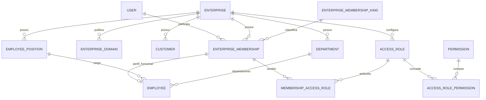

# Identidade e acesso: estrutura inicial

Implementado na branch `feat/83-CriacaoUsuarioLogin`. Esta etapa inclui classes, navigation properties, configurações EF, repositórios, DTOs, comandos de CRUD e controllers. Login, emissão/renovação de tokens, convites, verificação de domínio e policies de autorização serão implementados em outra etapa.

## Relacionamentos



`Enterprise` continua representando loja e tenant. `User` é global; `Customer` continua independente dentro de cada loja, sem FK para `User`.

## Entidades e tabelas

| Classe | Tabela | Relações principais |
|---|---|---|
| User | usuario | Memberships em uma ou mais lojas |
| Enterprise | empresa | Clientes, membros, domínios, cargos, departamentos e perfis |
| EnterpriseMembership | membro_empresa | User + Enterprise + Kind; perfil Employee opcional |
| EnterpriseMembershipKind | tipo_membro_empresa | 1: PrimaryOwner; 2: CoOwner; 3: Staff |
| EnterpriseDomain | dominio_empresa | Enterprise |
| Employee | funcionario | Membership + cargo + departamento da mesma loja |
| EmployeePosition | cargo | Enterprise; substitui o antigo Role |
| Department | departamento | Enterprise |
| Customer | cliente | Enterprise; e-mail único dentro da loja |
| AccessRole | papel_acesso | Enterprise; perfis configuráveis |
| Permission | permissao | Catálogo global com códigos definidos no sistema |
| AccessRolePermission | papel_acesso_permissao | AccessRole + Permission |
| MembershipAccessRole | membro_empresa_papel_acesso | Membership + AccessRole da mesma loja |

Os nomes de classes e propriedades estão em inglês, mantendo as tabelas em português e as colunas em snake_case, conforme o projeto.

## Mapeamento EF

- E-mail normalizado de `User`: único globalmente.
- E-mail normalizado de `Customer`: único por `EnterpriseId`, inclusive para contas excluídas logicamente.
- Membership: único por `(EnterpriseId, UserId)`.
- Índice parcial de membership: no máximo um `PrimaryOwner` ativo por loja.
- Domínio normalizado: único globalmente; no máximo um domínio marcado como primário por loja.
- Nome de cargo, departamento ou AccessRole: único dentro da loja.
- Employee: vínculo 1:1 com membership, sem credenciais próprias.
- AccessRolePermission: PK composta `(AccessRoleId, PermissionId)`.
- MembershipAccessRole: PK composta `(EnterpriseMembershipId, AccessRoleId)`.
- FKs compostas com `EnterpriseId` impedem associar funcionário, cargo, departamento, membership ou perfil de acesso de lojas diferentes.
- Exclusão das referências principais usa `DeleteBehavior.Restrict`.
- Entidades de loja e suas relações receberam query filters de tenant. O TenantProvider existente ainda depende da claim EnterpriseId; resolução por domínio e seleção autenticada de loja ficam para a etapa de autenticação.

O índice de dono principal garante **no máximo um**, não garante a existência de um. Cadastro transacional da loja, transferência, proteção do dono principal e gestão de acessos ainda precisam de seus casos de uso e autorização.

## Caminho das camadas

```text
Controller
  → Command/Query via MediatR
    → Handler de CRUD
      → Interface de repositório
        → Repositório EF
          → StoreCommerceDbContext + IEntityTypeConfiguration
```

Os CRUDs das novas entidades reutilizam os handlers-base de listas do projeto. `MappedCrudController` transforma os resultados em DTOs com campos escalares, evitando serializar ciclos de navigation properties ou devolver hashes de senha.

As relações com PK composta têm `IRelationshipRepository<T>` e controllers próprios; elas não possuem um Id artificial para encaixar no CRUD de BaseEntity.

## Endpoints

| Prefixo | Operações |
|---|---|
| /api/users | CRUD simples e em lote |
| /api/enterprise-memberships | CRUD simples e em lote |
| /api/enterprise-domains | CRUD simples e em lote |
| /api/access-roles | CRUD simples e em lote |
| /api/employee-positions | CRUD simples e em lote |
| /api/departments | CRUD existente adaptado ao tenant |
| /api/employees | CRUD existente vinculado à membership |
| /api/customers | CRUD existente adaptado à identidade por loja |
| /api/enterprises | CRUD existente da loja |
| /api/permissions | GET get-all e get-by-id/{id}; catálogo sem edição pública |
| /api/enterprise-membership-kinds | GET get-all |
| /api/access-role-permissions | POST add; GET get-all/get-by-key/{accessRoleId}/{permissionId}; DELETE delete/{accessRoleId}/{permissionId} |
| /api/membership-access-roles | POST add; GET get-all/get-by-key/{enterpriseMembershipId}/{accessRoleId}; DELETE delete/{enterpriseMembershipId}/{accessRoleId} |

Nos CRUDs de Id simples, os sufixos seguem a base existente: `add`, `add-range`, `update`, `update-range`, `delete/{id}`, `delete-range`, `get-all`, `get-by-id/{id}` e `get-list-by-list-id`.

As requisições desta etapa ainda têm IDs de relacionamento para cadastro estrutural. A futura camada de autenticação deverá obter o tenant e o ator do contexto confiável, e aplicar as regras de acesso antes de executar os casos de uso.

## Contratos ajustados

- User recebe nome, e-mail e status. Não recebe senha ou hash neste CRUD.
- Employee recebe EnterpriseId, EnterpriseMembershipId, nome, PositionId, DepartmentId, status e data de contratação. E-mail e PasswordHash deixam de pertencer ao funcionário.
- Customer recebe e-mail e telefone como strings, mapeados para os value objects existentes. PasswordHash foi retirado dos contratos públicos de criação/atualização.
- Hash de senha continua mapeado em User e Customer, mas é nullable enquanto o fluxo de credenciais não estiver implementado. Atualizar o perfil não altera a senha armazenada.
- EmailConfirmed, IsVerified do domínio e versões de segurança/acesso estão modelados, mas seus fluxos de validação/invalidação ainda não existem.
- Respostas de Employee e Customer preservam o campo Id e também oferecem EmployeeId/CustomerId, usados pelos contratos de integração do Drop.

## Revisão e próxima etapa

O catálogo inicial de Permission está em PermissionCodes e seu seed em PermissionConfiguration. A matriz de permissões por operação ainda precisa ser alinhada antes de criar policies ou handlers de autorização.

O modelo foi verificado com a compilação da solução e com `dotnet ef dbcontext info` / `dotnet ef dbcontext script`, sem aplicação de mudanças no banco. Não foi criado projeto de testes.

As migrations históricas permanecem intactas. A evolução de schema e eventual adaptação de dados existentes devem ser tratadas antes de utilizar os novos mapeamentos contra um banco criado pelas migrations atuais.
